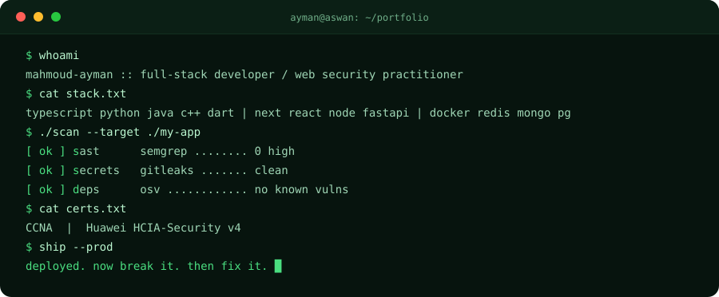
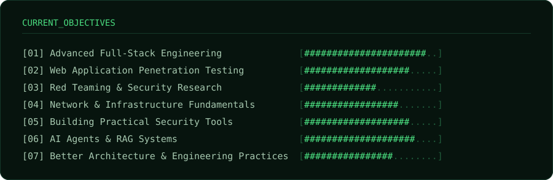

<div align="center">



<br/>

[](https://mahmoudayman.dev)
[](https://github.com/zAyman01)
[](https://www.linkedin.com/in/mahmoud-ayman-ez)
[](https://ieeeasw.dev)



</div>


## `01 // ABOUT_ME`

```bash
$ whoami
```

I'm **Mahmoud Ayman**, a Full-Stack Developer and junior penetration tester studying Computers and Information Sciences at the Egyptian E-Learning University (EELU), Aswan.

I work across the whole stack: interfaces, backend systems, and the security mechanisms that keep applications trustworthy. I build the thing, then I try to break it, then I fix what broke.

My work sits at the intersection of:

- **Software Engineering:** production-ready applications, real-time systems and well-structured backends.
- **Application Security:** OWASP Top 10, authentication security, vulnerability assessment and web penetration testing.
- **Systems & Networking:** infrastructure, protocols, and how software talks to software (CCNA certified).
- **AI Systems:** retrieval-augmented generation, evaluation, and putting AI agents to work on real engineering tasks.
- **Engineering Leadership:** mentoring developers and building technical communities.

I've shipped systems serving **500+ users**, taught programming and web development to **60+ students**, and take on freelance full-stack work (marketplaces, SaaS and ERP platforms, chatbots, e-commerce).

```json
{
  "name": "Mahmoud Ayman",
  "roles": ["Full-Stack Developer", "Junior Penetration Tester"],
  "studies": "Computers & Information Sciences @ EELU",
  "leads": "Web Team @ IEEE Aswan Student Branch",
  "certs": ["CCNA", "Huawei HCIA-Security v4"],
  "practice": ["TryHackMe", "PortSwigger Web Security Academy", "Burp Suite", "Metasploit"],
  "mindset": "build it :: break it :: fix it"
}
```

<div align="center">

</div>

```bash
$ cat /etc/motivation
```

> I don't want to just know how to build something.
> I want to understand why it works, where it fails, and how to make it better.


## `02 // ENGINEERING_STACK`

<details open>
<summary><b>Languages & Core Foundations</b></summary>
<br/>


Data Structures & Algorithms · OOP · Database Design · Computer Networks
</details>

<details open>
<summary><b>Frontend Engineering</b></summary>
<br/>


Responsive UI · Component Architecture · UI/UX Implementation · API Integration · i18n and RTL layouts
</details>

<details open>
<summary><b>Backend & Databases</b></summary>
<br/>


REST APIs · JWT & Session Security · Real-time Systems · Background Jobs (BullMQ, Celery) · Vector Search · RAG Pipelines
</details>

<details open>
<summary><b>Security, Networking & Infrastructure</b></summary>
<br/>


Web Application Security · OWASP Top 10 · Secure Authentication · Vulnerability Scanning · SAST · Dependency Analysis · Packet Analysis (Scapy) · CI/CD · Cloud Deployments
</details>


## `03 // CERTIFICATIONS_&_TRAINING`

[](https://www.linkedin.com/in/mahmoud-ayman-ez)
[](https://www.linkedin.com/in/mahmoud-ayman-ez)

[](https://tryhackme.com)
[](https://portswigger.net/web-security)

Hands-on practice through TryHackMe rooms and a large number of PortSwigger Web Security Academy labs, using Burp Suite and Metasploit.


## `04 // SELECTED_PROJECTS`

I prefer building projects that solve real problems and involve real engineering decisions.

### DocuMind
**RAG-powered document intelligence platform**

Upload documents and chat with their contents using retrieval-augmented generation.

- Next.js, Express.js and MongoDB Atlas.
- Hybrid retrieval combining vector search and BM25, reranked with Maximal Marginal Relevance (MMR).
- BGE embeddings and semantic document chunking.
- Real-time response streaming using SSE.
- JWT authentication with short-lived access tokens and HTTP-only refresh cookies.
- BullMQ and Redis for background processing.

### SecureScout
**Automated application security analysis**

A security platform that helps developers find vulnerabilities and leaked secrets in their codebases.

- Next.js and FastAPI.
- PostgreSQL, Redis and Celery.
- Semgrep for static analysis, Gitleaks for exposed secrets, OSV for dependency vulnerabilities.
- AI-assisted security analysis.
- Isolated execution environments.

### Netscope
**Smart-home network analyzer**

Per-device bandwidth tracking built on ARP-based traffic interception with Scapy. It grew out of a simpler home data-usage tracker and now deals with the real-world problems of the approach: MAC address randomization, forwarding slowdowns, packet-drop accuracy and ARP-resistant devices.

### MedLens
**Citation-grounded medical guideline RAG**

A 5-person team project for the AI Hackathons organized by ITIDA, TIEC, Creativa and Orange Digital Center (Aug 2026). An evidence-grounded, traceable retrieval system over official guidelines (WHO, CDC, NICE, USPSTF), judged on retrieval quality, grounding and citation, architecture, evaluation depth, and safety.

### Basira
**AI Financial Leak Detector | NFTE ESB 2026**

An AI-powered concept that helps Egyptian SMEs and real-estate developers find financial leakage and overlooked financial risk.

> We don't just save time — we find money.

### More builds

| Project | What it is | Stack |
|---|---|---|
| **IEEE Aswan platform** | Branch website with dashboard, events, archive, ticketing and certificate emails ([ieeeasw.dev](https://ieeeasw.dev)) | Full-stack, deployed on Heroku |
| **Codestorm 3.0 judge** | 1v1 competitive-programming contest hosted on the branch site, judged only through the Codeforces API | Full-stack, Codeforces API |
| **Task board** | Trello-style collaborative board with real-time updates | React, REST + WebSocket |
| **Travel Express** | Internal management system for tourism trip packages | Next.js, Express, MongoDB, next-intl, Cloudinary |
| **BookHouse** | Literary platform built with the IEEE web team as hands-on training | Team project |


## `05 // BUILD_IT_BREAK_IT`

<div align="center">

</div>

Security is not a separate phase for me. It shapes how I design authentication, how I structure APIs, and how I review code. I run SAST and secret scanning on my own projects, practice on intentionally vulnerable targets, and study how real systems fail.


## `06 // BEYOND_CODE`

### IEEE Aswan Student Branch

**Web Team Head | Season 2025–2026**

Engineering is also about people, collaboration and sharing knowledge. This season I led a 13-person web team across UI/UX, frontend and backend, and our work reached **500+ registrations** across the branch's events.

- Planned and built a **full new branch website** (dashboard, events, archive) and migrated it from the old site, after auditing the old one for security and performance.
- Built and hosted **Codestorm 3.0** (64 contestants): a 1v1 competitive-programming contest running entirely on the branch site, judged through the Codeforces API.
- Built the landing page, registration and the **judging system** for **IEEE Olympics** (240 registrations), including a 1v1 Problem Solving contest and a scoring and leaderboard system for the Create with AI competition.
- Built event pages, confirmation emails, tickets and certificate delivery for **Bein 8** (120 registrations) and the volunteer recruitment form (120+).
- Ran a **30-hour web basics workshop** at SkillHub and trained the team on a real project (BookHouse) before real production work.

I've also participated in the 2nd Afro-Asian Conference, Mobile Application track.

**Next up:** a hands-on AI agents workshop for the branch, covering context, tokens, skills, MCPs and connectors, with live demos.

I also write illustrated, print-ready study guides for university and secondary-school IT and AI courses.

[](https://ieeeasw.dev)


## `07 // CURRENT_FOCUS`

<div align="center">

</div>

I'm especially interested in bridging the gap between building applications and testing their security. The goal is to be an engineer who understands both sides: how to build reliable systems and how to think like someone trying to break them.

**Side quest:** exploring a performance-focused open-source browser in Rust, built on the Servo engine. A feasibility study is done and the plan is ambitious on purpose.


## `08 // GITHUB_ACTIVITY`

<div align="center">


</div>


## `09 // CONNECT`

I'm always interested in connecting with developers, security enthusiasts and people building interesting things.

<div align="center">

[](https://mahmoudayman.dev)

[](https://github.com/zAyman01)
[](https://www.linkedin.com/in/mahmoud-ayman-ez)
[](https://ieeeasw.dev)



**The best systems are built by people who understand how they can fail.**

</div>
